# Serverless-Architecture-Automatic-EBS-Sanpshot-and-Cleanup-using-AWS-Lambda-and-Boto3
A Serverless method to automatically capture an EBS snapshot and Cleanup using AWS Lambda &amp; Boto 3

By **rajkumaramithn**


## Overview

**Objective:** Automate the backup process for **EBS** volumes and clean up backups older than a retention period to save costs.

**What this project does:**

- Uses an **EBS** volume as the backup target.
- Creates an **IAM** role that lets Lambda manage **EC2** snapshots.
- Deploys a Python Lambda function that creates a snapshot of the volume, lists the volume's snapshots, deletes those older than the retention period, and logs the IDs of created and deleted snapshots.
- Invokes the function manually and verifies the result in the **EC2** console.

**Services used:** Amazon **EBS**, Amazon **EC2**, **AWS** Lambda, **AWS** **IAM**, Boto3 (**AWS** **SDK** for Python).

---

## Architecture


---

## Prerequisites

- An **AWS** account with access to the **AWS** Management Console
- Basic familiarity with Python
- A single **AWS** region used consistently for all resources (this project used `<**YOUR**-**REGION**>`, e.g. `ap-south-1`)
- Awareness that snapshots incur cost: a **1 GiB** volume is used and all resources are deleted at the end

---

## Step 1: EBS Setup

### 1.1 Select the region

Sign in to the **AWS** Console and choose the region used for the whole project.

### 1.2 Create the EBS volume

## Open **EC2** → **Elastic Block Store** → **Volumes** → **Create volume**.

2. **Volume type:** General Purpose **SSD** (gp3)
3. **Size:** `1` GiB
4. **Availability Zone:** `<**YOUR**-AZ>` (e.g. `ap-south-1a`)
5. **Tags:** `Name` = `backup-demo-volume`
## Click **Create volume**.

No **EC2** instance is needed, because snapshots can be taken of unattached volumes.


### 1.3 Note the Volume ID

Wait until **Volume state** shows **Available**, then copy the **Volume ID** (`vol-xxxxxxxxxxxxxxxxx`).

📸 ****ATTACH** **SCREENSHOT** 3:** The **Volumes** list showing your volume, its **Volume ID**, and the **Available** state


---

## Step 2: IAM Role for Lambda

## Open **IAM** → **Roles** → **Create role**.

2. **Trusted entity type:** **AWS** service. **Use case:** Lambda. Click **Next**.
## Search for and select `AmazonEC2FullAccess`.
## Click **Next**, name the role `lambda-ebs-snapshot-role`, and click **Create role**.

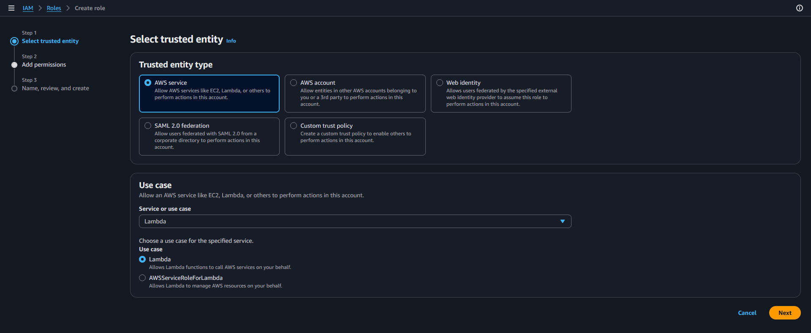

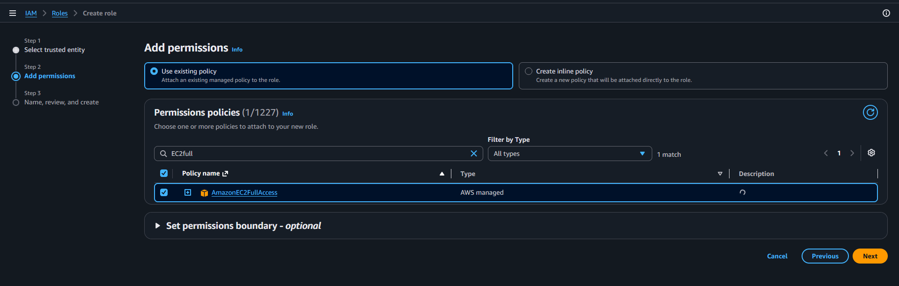

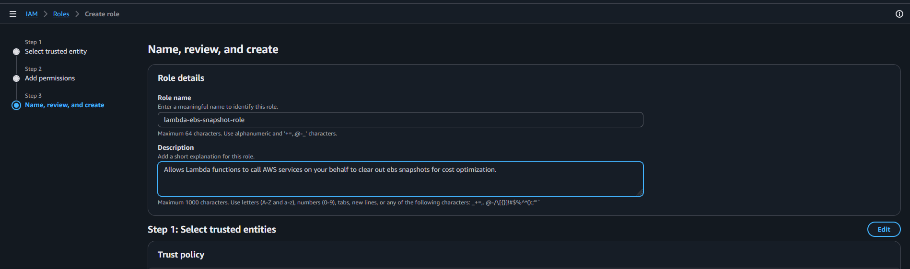

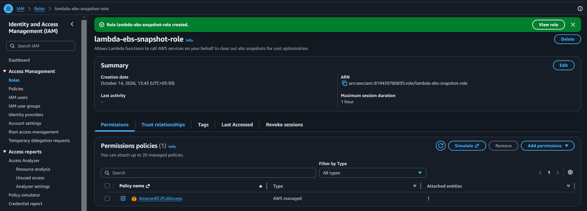

> **Note:** `AmazonEC2FullAccess` is used here because the assignment specifies it. See [Security Considerations](#security-considerations) for a least-privilege alternative.

---

## Step 3: Create the Lambda Function

### 3.1 Create the function

## Open **Lambda** → **Create function** → **Author from scratch**.

2. **Function name:** `ebs-snapshot-cleanup`
3. **Runtime:** Python 3.12
4. **Execution role:** Use an existing role → `lambda-ebs-snapshot-role`
## Click **Create function**.

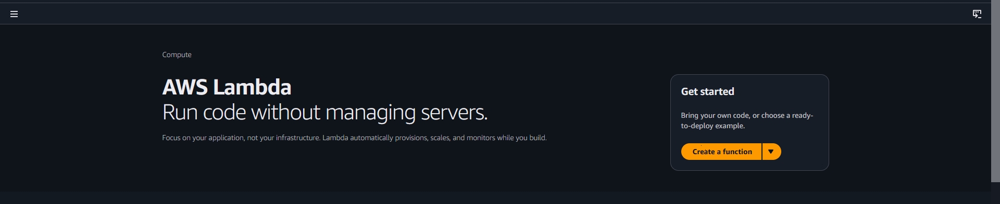


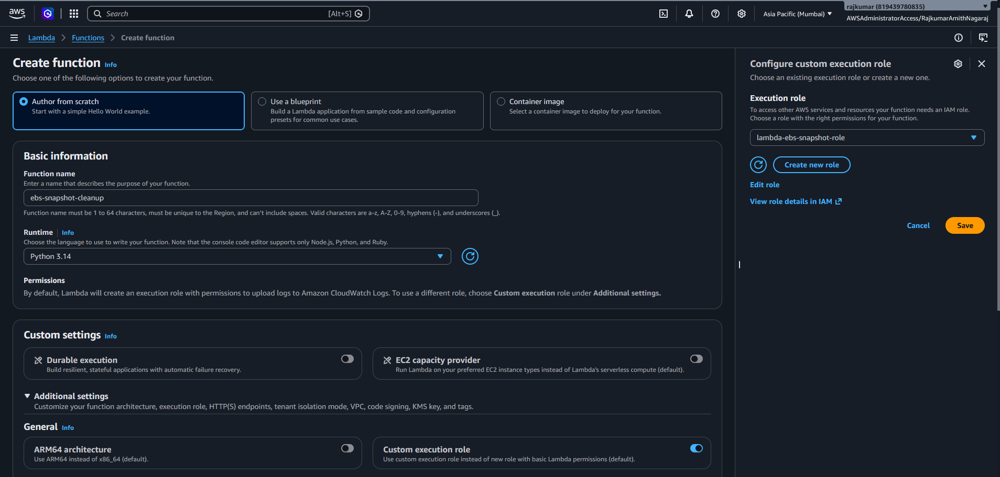


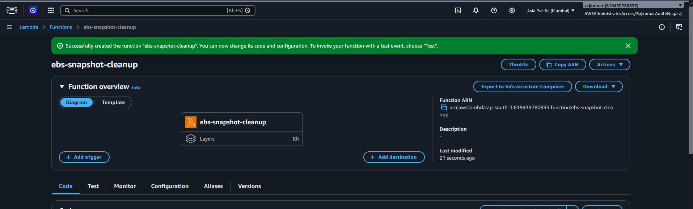

### 3.2 Add the code

Refer to lambda_function.py file for the code

Paste the following into `lambda_function.py` on the Lambda function console and click **Deploy**:

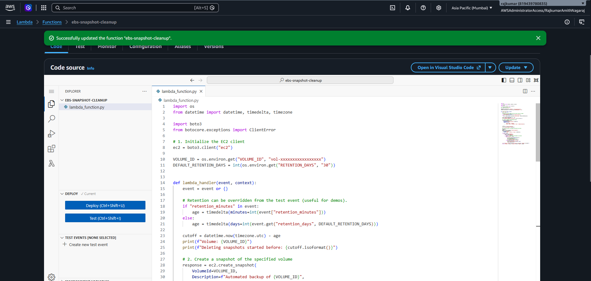

### 3.3 Code explanation

| Step | Requirement | Implementation |
|------|-------------|----------------|
| 1 | Initialize a boto3 EC2 client | `ec2 = boto3.client(*ec2*)` |
| 2 | Create a snapshot for the specified volume | `create_snapshot(VolumeId=...)`, tagged `CreatedBy=lambda-ebs-backup` |
| 3 | List snapshots and delete those older than 30 days | `describe_snapshots` via a paginator, then `delete_snapshot` when `StartTime` is before the cutoff |
| 4 | Print created and deleted snapshot IDs | `print()` statements, which appear in CloudWatch Logs |

**Design choices:**

- **Own snapshots only:** `OwnerIds=[*self*]` prevents the function from seeing public or shared snapshots.
- **This volume only:** the `volume-id` filter limits deletion to snapshots of the configured volume.
- **Newest snapshot protected:** the snapshot just created is explicitly skipped.
- **Resilient deletion:** a snapshot that cannot be deleted (for example, one used by an **AMI**) is logged and skipped instead of crashing the function.
- **Configurable retention:** defaults to **30 days** via the `RETENTION_DAYS` environment variable and can be overridden per invocation.
- ****UTC**-aware datetimes:** `datetime.now(timezone.utc)` matches the timezone-aware `StartTime` values returned by **EC2**.

### 3.4 Configure environment variables

Under **Configuration** → **Environment variables**, add:

| Key | Value |
|-----|-------|
| `VOLUME_ID` | `<YOUR-VOLUME-ID>` |
| `RETENTION_DAYS` | `30` |

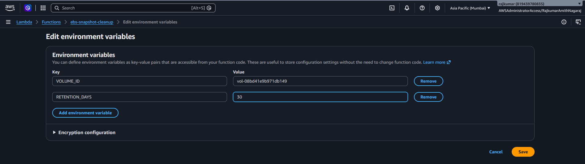

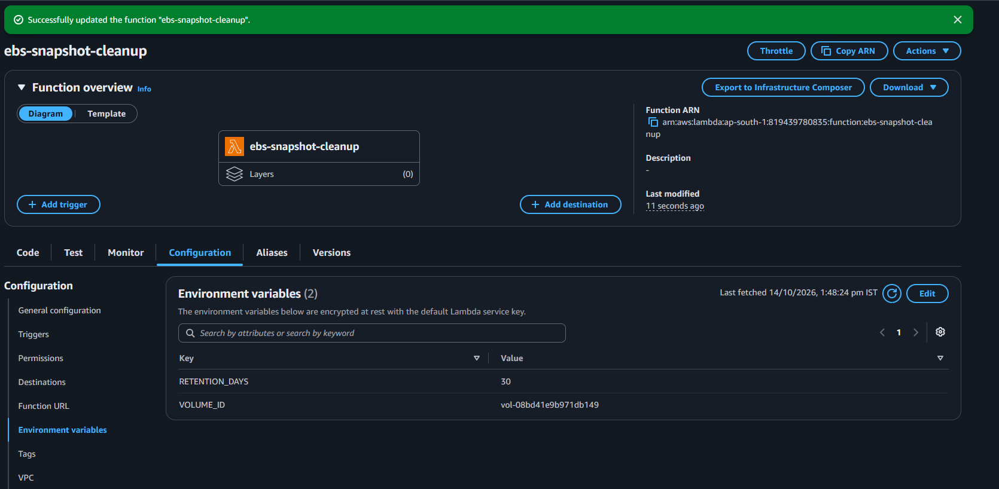

### 3.5 Increase the timeout

Under **Configuration** → **General configuration**, set **Timeout** to **30 seconds**.

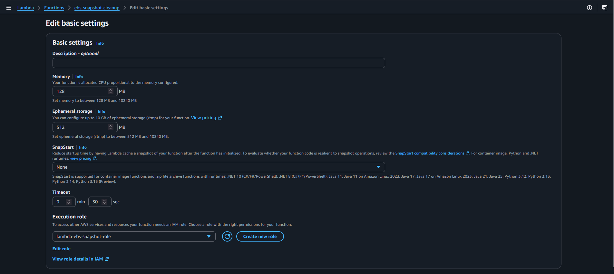

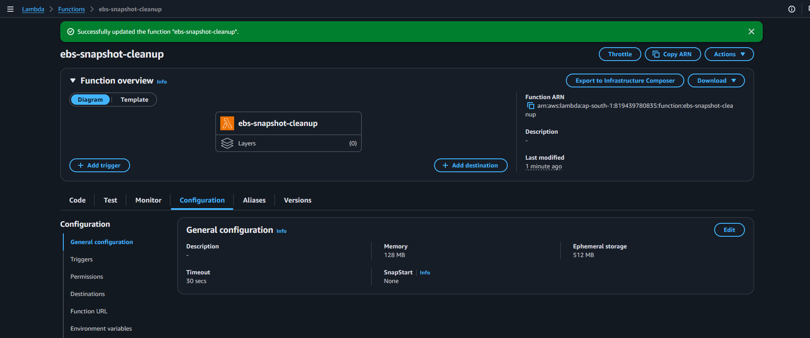

---

## Step 4: Manual Invocation and Verification

### 4.1 Create the test event

On the **Test** tab, create an event named `demo-5-min-cutoff` with this **JSON**:

```json { *retention_minutes*: 5 } ```

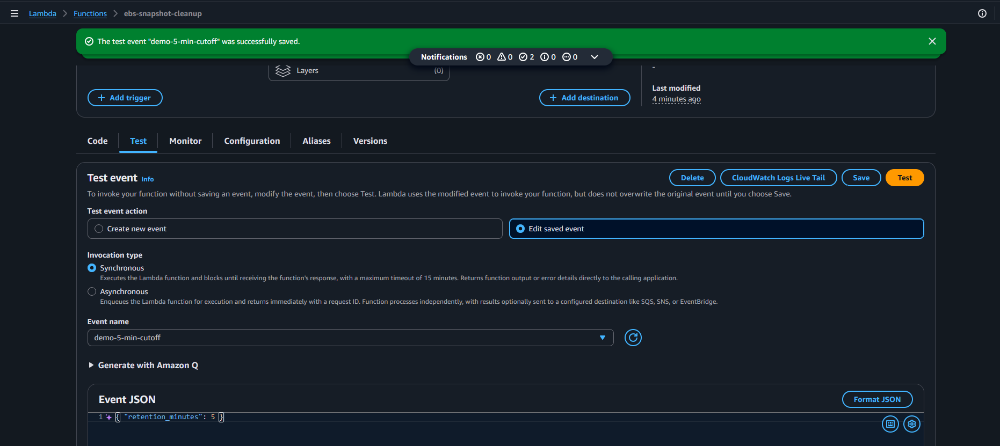

### 4.2 Create the *old* snapshots

Click **Test** twice, about 30 seconds apart. Each run creates one snapshot, and nothing is deleted because nothing is older than 5 minutes yet.

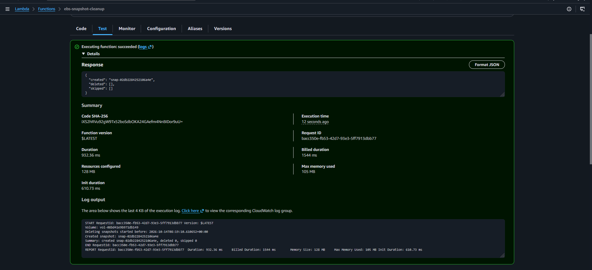

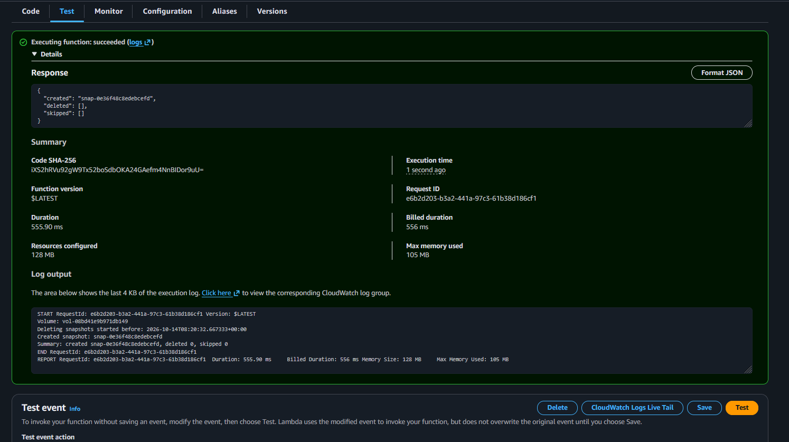

### 4.3 Snapshots before cleanup

Open **EC2** → **Elastic Block Store** → **Snapshots**.

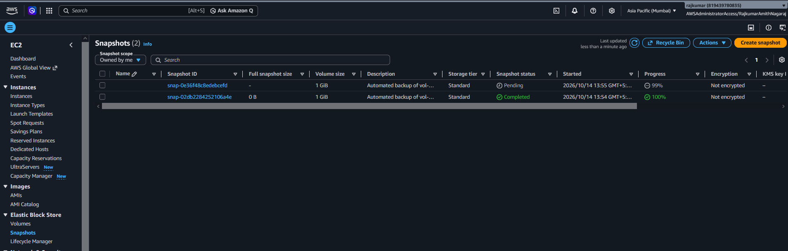

### 4.4 Run the cleanup

Wait 6 to 7 minutes so the first two snapshots are older than the 5-minute cutoff, then click **Test** again. This run creates a new snapshot and deletes the two old ones.

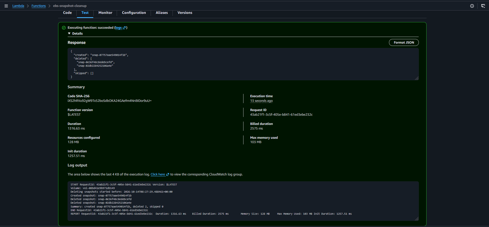.

### 4.5 Snapshots after cleanup

Return to **EC2** → **Snapshots** and refresh.

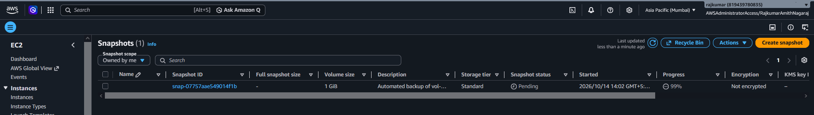

### 4.6 Default 30-day behavior (optional)

Create a second test event `default-30-days` with `{}` as the **JSON** and run it. It creates one new snapshot and deletes nothing, because no snapshot is 30 days old yet.

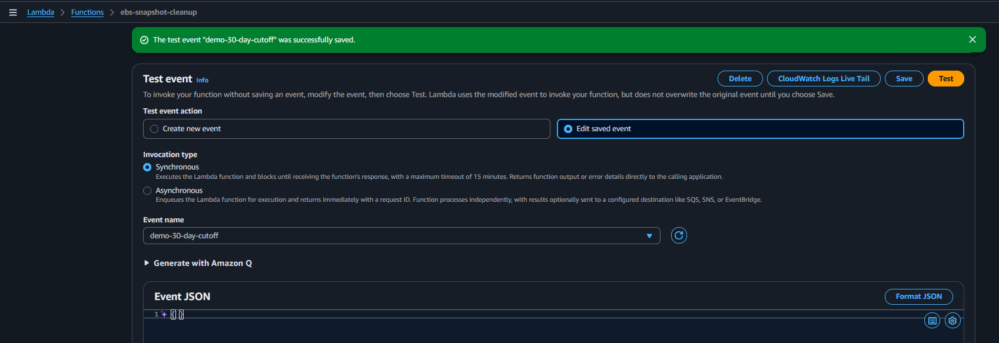

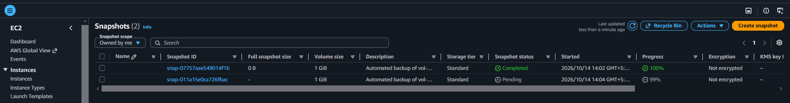

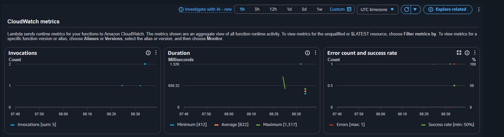

---

## Note on Testing Old Snapshots

A snapshot's `StartTime` is assigned by **AWS** when the snapshot is created. It cannot be backdated, and changing the local system clock has no effect, so a genuine 30-day-old snapshot cannot be produced during testing.

To demonstrate the deletion logic anyway, the function accepts an optional `retention_minutes` value in the event payload. The cutoff logic is identical for minutes or days. With no override, the function enforces the required **30-day** retention.

In the demonstration projected in the screenshots of this project , the cleanup is scheduled for snapshots older than 5 mins, However by default the function is designed to deleted snapshots older than 30 days.

---

## Security Considerations

`AmazonEC2FullAccess` grants far more than this function needs. For a real deployment, replace it with a least-privilege policy:

```json
{
    *Version*: ***2012**-10-17*,
    *Statement*: [
    {
    *Effect*: *Allow*,
    *Action*: [
    *ec2:CreateSnapshot*,
    *ec2:CreateTags*,
    *ec2:DescribeSnapshots*,
    *ec2:DeleteSnapshot*
    ],
    *Resource*: ***
    }
    ]
}
```

Recommendations:

- Scope `CreateSnapshot` and `DeleteSnapshot` further using resource ARNs or tag conditions (e.g. only snapshots tagged `CreatedBy=lambda-ebs-backup`).
- Consider **Amazon Data Lifecycle Manager (**DLM**)** for production. It provides scheduled snapshots with retention natively, with no code to maintain. This project uses Lambda to practise Boto3 and serverless automation.
- Delete snapshots only after confirming they are not required by any **AMI** or compliance policy.

---

## Troubleshooting

| Problem | Likely cause | Fix |
|---------|--------------|-----|
| `UnauthorizedOperation` | Role lacks EC2 permissions or is not attached to the function | Check **Configuration** → **Permissions** |
| `InvalidVolume.NotFound` | Typo in `VOLUME_ID`, or volume is in a different region | Verify the ID and region |
| `SnapshotCreationPerVolumeLimitExceeded` | Too many snapshots pending on the volume at once | Wait a minute and retry |
| `InvalidSnapshot.InUse` in logs | Snapshot backs an AMI | Expected; the function skips it |
| `Task timed out` | Default 3-second timeout | Increase the timeout to 30 seconds |
| Nothing deleted | Old snapshots are not yet older than the cutoff | Check **Started** times; wait longer or lower `retention_minutes` |

---

## Conclusion

This project automated **EBS** backups and retention with a Boto3-based Lambda function. It covered creating an **EBS** volume, configuring an **IAM** execution role, writing a function that creates snapshots and deletes expired ones.

---
