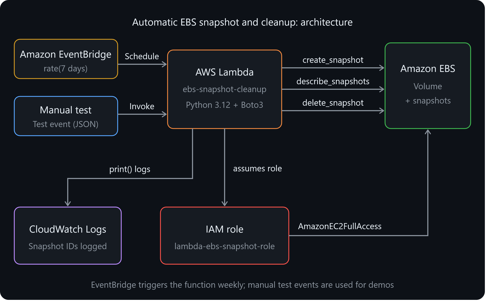
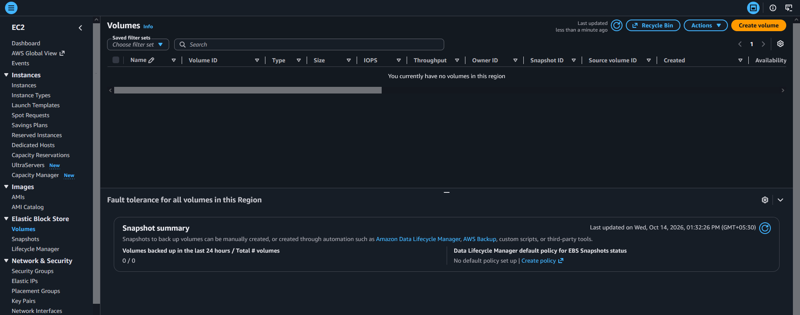
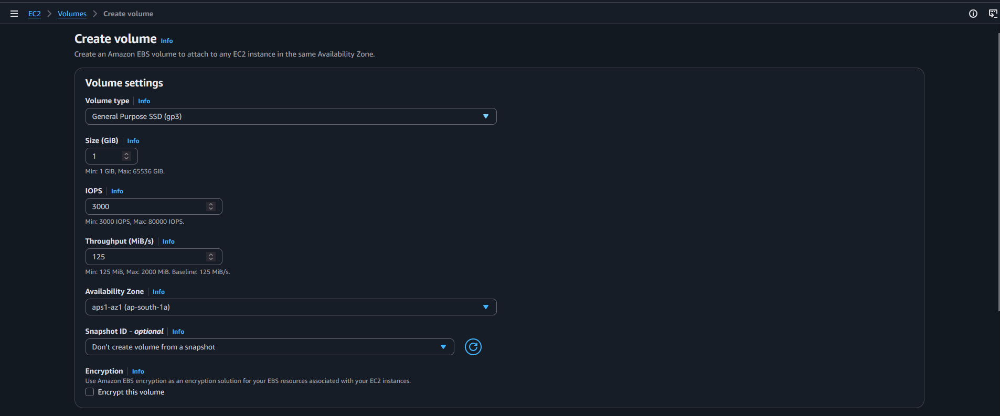
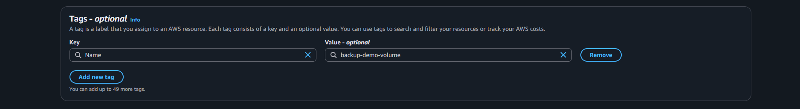
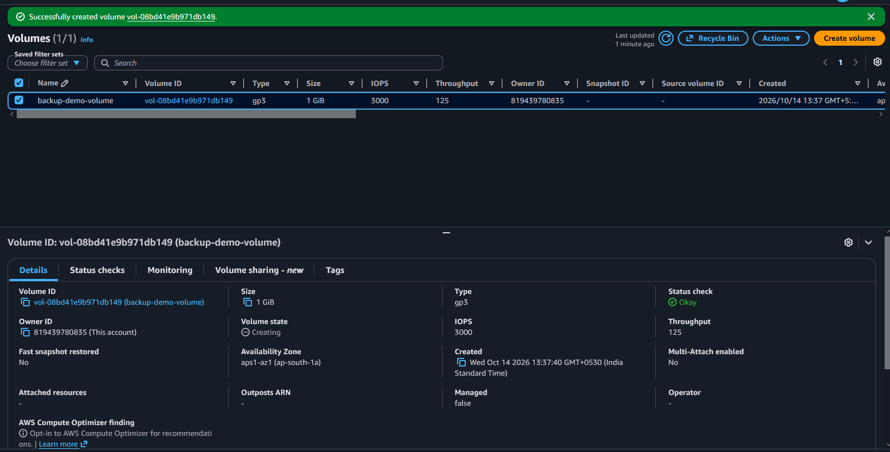

# Serverless-Architecture-Automatic-EBS-Sanpshot-and-Cleanup-using-AWS-Lambda-and-Boto3
A Serverless method to automatically capture an EBS snapshot and Cleanup using AWS Lambda &amp; Boto 3

By **rajkumaramithn**


## Overview

**Objective:** Automate the backup process for **EBS** volumes and clean up backups older than a retention period to save costs.

**What this project does:**

- Uses an **EBS** volume as the backup target.
- Creates an **IAM** role that lets Lambda manage **EC2** snapshots.
- Deploys a Python Lambda function that creates a snapshot of the volume, lists the volume's snapshots, deletes those older than the retention period, and logs the IDs of created and deleted snapshots.
- Invokes the function manually and verifies the result in the **EC2** console.

**Services used:** Amazon **EBS**, Amazon **EC2**, **AWS** Lambda, **AWS** **IAM**, Boto3 (**AWS** **SDK** for Python).

---

## Architecture



---

## Prerequisites

- An **AWS** account with access to the **AWS** Management Console
- Basic familiarity with Python
- A single **AWS** region used consistently for all resources (this project used `<**YOUR**-**REGION**>`, e.g. `ap-south-1`)
- Awareness that snapshots incur cost: a **1 GiB** volume is used and all resources are deleted at the end

---

## Step 1: EBS Setup

### 1.1 Select the region

Sign in to the **AWS** Console and choose the region used for the whole project.

### 1.2 Create the EBS volume

## Open **EC2** → **Elastic Block Store** → **Volumes** → **Create volume**.

2. **Volume type:** General Purpose **SSD** (gp3)
3. **Size:** `1` GiB
4. **Availability Zone:** `<**YOUR**-AZ>` (e.g. `ap-south-1a`)
5. **Tags:** `Name` = `backup-demo-volume`
## Click **Create volume**.

No **EC2** instance is needed, because snapshots can be taken of unattached volumes.







### 1.3 Note the Volume ID

Wait until **Volume state** shows **Available**, then copy the **Volume ID** (`vol-xxxxxxxxxxxxxxxxx`).

📸 ****ATTACH** **SCREENSHOT** 3:** The **Volumes** list showing your volume, its **Volume ID**, and the **Available** state




---

## Step 2: IAM Role for Lambda

## Open **IAM** → **Roles** → **Create role**.

2. **Trusted entity type:** **AWS** service. **Use case:** Lambda. Click **Next**.
## Search for and select `AmazonEC2FullAccess`.
## Click **Next**, name the role `lambda-ebs-snapshot-role`, and click **Create role**.

📸 ****ATTACH** **SCREENSHOT** 4:** The **Add permissions** page with `AmazonEC2FullAccess` ticked


📸 ****ATTACH** **SCREENSHOT** 5:** The role **summary page** showing the attached policy


> **Note:** `AmazonEC2FullAccess` is used here because the assignment specifies it. See [Security Considerations](#security-considerations) for a least-privilege alternative.

---

## Step 3: Create the Lambda Function

### 3.1 Create the function

## Open **Lambda** → **Create function** → **Author from scratch**.

2. **Function name:** `ebs-snapshot-cleanup`
3. **Runtime:** Python 3.12
4. **Execution role:** Use an existing role → `lambda-ebs-snapshot-role`
## Click **Create function**.

📸 ****ATTACH** **SCREENSHOT** 6:** The **Create function** form with the runtime and existing role visible


📸 ****ATTACH** **SCREENSHOT** 7:** The function **overview page** after creation


### 3.2 Add the code

Paste the following into `lambda_function.py` and click **Deploy**:

```python import os from datetime import datetime, timedelta, timezone

import boto3 from botocore.exceptions import ClientError

# 1. Initialize the EC2 client

ec2 = boto3.client(*ec2*)

VOLUME_ID = os.environ.get(*VOLUME_ID*, *vol-xxxxxxxxxxxxxxxxx*) DEFAULT_RETENTION_DAYS = int(os.environ.get(*RETENTION_DAYS*, *30*))

def lambda_handler(event, context):
    event = event or {}

    # Retention can be overridden from the test event (useful for demos).
    if *retention_minutes* in event:
    age = timedelta(minutes=int(event[*retention_minutes*]))
    else:
    age = timedelta(days=int(event.get(*retention_days*, DEFAULT_RETENTION_DAYS)))

    cutoff = datetime.now(timezone.utc) - age
    print(f*Volume: {VOLUME_ID}*)
    print(f"Deleting snapshots started before: {cutoff.isoformat()}")

    # 2. Create a snapshot of the specified volume
    response = ec2.create_snapshot(
    VolumeId=VOLUME_ID,
    Description=f*Automated backup of {VOLUME_ID}*,
    TagSpecifications=[
    {
    *ResourceType*: *snapshot*,
    *Tags*: [{*Key*: *CreatedBy*, *Value*: *lambda-ebs-backup*}],
    }
    ],
    )
    created_id = response[*SnapshotId*]
    print(f*Created snapshot: {created_id}*)

    # 3. List this volume's own snapshots and delete the old ones
    deleted = []
    skipped = []
    paginator = ec2.get_paginator(*describe_snapshots*)
    pages = paginator.paginate(
    OwnerIds=[*self*],
    Filters=[{*Name*: *volume-id*, *Values*: [VOLUME_ID]}],
    )
    for page in pages:
    for snap in page[*Snapshots*]:
    snap_id = snap[*SnapshotId*]
    if snap_id == created_id:
    continue  # never delete the snapshot we just made
    if snap[*StartTime*] < cutoff:
    try:
    ec2.delete_snapshot(SnapshotId=snap_id)
    deleted.append(snap_id)
    # 4. Log the deleted snapshot ID
    print(f*Deleted snapshot: {snap_id}*)
    except ClientError as err:
    code = err.response[*Error*][*Code*]
    print(f*Could not delete {snap_id}: {code}*)
    skipped.append(snap_id)

    print(f"Summary: created {created_id}, deleted {len(deleted)}, skipped {len(skipped)}*)
    return {*created*: created_id, *deleted*: deleted, *skipped": skipped}
```

📸 ****ATTACH** **SCREENSHOT** 8:** The code editor showing the **full script** and the ***Successfully updated the function*** banner


### 3.3 Code explanation

| Step | Requirement | Implementation |
|------|-------------|----------------|
| 1 | Initialize a boto3 EC2 client | `ec2 = boto3.client(*ec2*)` |
| 2 | Create a snapshot for the specified volume | `create_snapshot(VolumeId=...)`, tagged `CreatedBy=lambda-ebs-backup` |
| 3 | List snapshots and delete those older than 30 days | `describe_snapshots` via a paginator, then `delete_snapshot` when `StartTime` is before the cutoff |
| 4 | Print created and deleted snapshot IDs | `print()` statements, which appear in CloudWatch Logs |

**Design choices:**

- **Own snapshots only:** `OwnerIds=[*self*]` prevents the function from seeing public or shared snapshots.
- **This volume only:** the `volume-id` filter limits deletion to snapshots of the configured volume.
- **Newest snapshot protected:** the snapshot just created is explicitly skipped.
- **Resilient deletion:** a snapshot that cannot be deleted (for example, one used by an **AMI**) is logged and skipped instead of crashing the function.
- **Configurable retention:** defaults to **30 days** via the `RETENTION_DAYS` environment variable and can be overridden per invocation.
- ****UTC**-aware datetimes:** `datetime.now(timezone.utc)` matches the timezone-aware `StartTime` values returned by **EC2**.

### 3.4 Configure environment variables

Under **Configuration** → **Environment variables**, add:

| Key | Value |
|-----|-------|
| `VOLUME_ID` | `<YOUR-VOLUME-ID>` |
| `RETENTION_DAYS` | `30` |

📸 ****ATTACH** **SCREENSHOT** 9:** The **Environment variables** page showing both saved values


### 3.5 Increase the timeout

Under **Configuration** → **General configuration**, set **Timeout** to **30 seconds**.

📸 ****ATTACH** **SCREENSHOT** 10:** The **General configuration** panel showing the new timeout


---

## Step 4: Manual Invocation and Verification

### 4.1 Create the test event

On the **Test** tab, create an event named `demo-5-min-cutoff` with this **JSON**:

```json { *retention_minutes*: 5 } ```

📸 ****ATTACH** **SCREENSHOT** 11:** The **test event configuration** with the name and **JSON** visible


### 4.2 Create the *old* snapshots

Click **Test** twice, about 30 seconds apart. Each run creates one snapshot, and nothing is deleted because nothing is older than 5 minutes yet.

📸 ****ATTACH** **SCREENSHOT** 12:** One **execution result** showing **Succeeded** and the `Created snapshot: snap-...` log line


### 4.3 Snapshots before cleanup

Open **EC2** → **Elastic Block Store** → **Snapshots**.

📸 ****ATTACH** **SCREENSHOT** 13 (**BEFORE**):** The **Snapshots** list showing the 2 snapshots and their **Started** times


### 4.4 Run the cleanup

Wait 6 to 7 minutes so the first two snapshots are older than the 5-minute cutoff, then click **Test** again. This run creates a new snapshot and deletes the two old ones.

📸 ****ATTACH** **SCREENSHOT** 14:** The **execution result** showing **Succeeded**, the created ID, and the **two deleted IDs** in the returned **JSON**


### 4.5 CloudWatch logs

Click **View CloudWatch logs** and open the latest log stream.

📸 ****ATTACH** **SCREENSHOT** 15:** The log stream showing the `Created snapshot:` and `Deleted snapshot:` lines


### 4.6 Snapshots after cleanup

Return to **EC2** → **Snapshots** and refresh.

📸 ****ATTACH** **SCREENSHOT** 16 (**AFTER**):** The **Snapshots** list showing **only the newest snapshot**


### 4.7 Default 30-day behaviour (optional)

Create a second test event `default-30-days` with `{}` as the **JSON** and run it. It creates one new snapshot and deletes nothing, because no snapshot is 30 days old yet.

📸 ****ATTACH** **SCREENSHOT** 17:** The output showing `*deleted*: []`


---

## Step 5 (Bonus): Schedule with EventBridge

Amazon CloudWatch Events is now part of **Amazon EventBridge**; the Lambda console uses the combined name.

### 5.1 Add the trigger

## In the function, click **Add trigger** → **EventBridge (CloudWatch Events)**.

2. **Rule:** Create a new rule
3. **Rule name:** `ebs-backup-weekly`
4. **Rule type:** Schedule expression
5. **Schedule expression:** `rate(7 days)`
   (Alternative for a fixed time: `cron(0 2 ? * **SUN** *)`, which means every Sunday at 02:00 **UTC**.)
## Click **Add**.

📸 ****ATTACH** **SCREENSHOT** 18:** The **Add trigger** form filled in


📸 ****ATTACH** **SCREENSHOT** 19:** The function **overview** showing EventBridge connected to the function


### 5.2 Verify the rule

Open **EventBridge** → **Rules** → `ebs-backup-weekly`.

📸 ****ATTACH** **SCREENSHOT** 20:** The **rule page** showing the schedule and the Lambda function as target


### 5.3 Prove the schedule fires

To avoid waiting a week, the schedule was temporarily changed to `rate(5 minutes)`. After about 6 minutes, a new log stream appeared in CloudWatch without any manual invocation.

📸 ****ATTACH** **SCREENSHOT** 21:** A **log stream created automatically** (not by clicking Test) showing the `Created snapshot:` line


### 5.4 Restore the schedule

The schedule was set back to `rate(7 days)` (or the rule disabled) so it stops creating snapshots every 5 minutes.

📸 ****ATTACH** **SCREENSHOT** 22:** The **rule** showing the restored schedule, or **Disabled** status


---

## Note on Testing Old Snapshots

A snapshot's `StartTime` is assigned by **AWS** when the snapshot is created. It cannot be backdated, and changing the local system clock has no effect, so a genuine 30-day-old snapshot cannot be produced during testing.

To demonstrate the deletion logic anyway, the function accepts an optional `retention_minutes` value in the event payload. The cutoff logic is identical for minutes or days. With no override, the function enforces the required **30-day** retention.

---

## Security Considerations

`AmazonEC2FullAccess` grants far more than this function needs. For a real deployment, replace it with a least-privilege policy:

```json
{
    *Version*: ***2012**-10-17*,
    *Statement*: [
    {
    *Effect*: *Allow*,
    *Action*: [
    *ec2:CreateSnapshot*,
    *ec2:CreateTags*,
    *ec2:DescribeSnapshots*,
    *ec2:DeleteSnapshot*
    ],
    *Resource*: ***
    }
    ]
}
```

Other recommendations:

- Scope `CreateSnapshot` and `DeleteSnapshot` further using resource ARNs or tag conditions (e.g. only snapshots tagged `CreatedBy=lambda-ebs-backup`).
- Consider **Amazon Data Lifecycle Manager (**DLM**)** for production. It provides scheduled snapshots with retention natively, with no code to maintain. This project uses Lambda to practise Boto3 and serverless automation.
- Delete snapshots only after confirming they are not required by any **AMI** or compliance policy.

---

## Troubleshooting

| Problem | Likely cause | Fix |
|---------|--------------|-----|
| `UnauthorizedOperation` | Role lacks EC2 permissions or is not attached to the function | Check **Configuration** → **Permissions** |
| `InvalidVolume.NotFound` | Typo in `VOLUME_ID`, or volume is in a different region | Verify the ID and region |
| `SnapshotCreationPerVolumeLimitExceeded` | Too many snapshots pending on the volume at once | Wait a minute and retry |
| `InvalidSnapshot.InUse` in logs | Snapshot backs an AMI | Expected; the function skips it |
| `Task timed out` | Default 3-second timeout | Increase the timeout to 30 seconds |
| Nothing deleted | Old snapshots are not yet older than the cutoff | Check **Started** times; wait longer or lower `retention_minutes` |

---

## Cleanup

To avoid charges, remove resources in this order:

## Delete the **EventBridge rule** `ebs-backup-weekly`.

## Delete all remaining **snapshots**. ## Delete the **EBS volume**. ## Delete the **Lambda function**. ## Delete the **IAM role** `lambda-ebs-snapshot-role`.

📸 ****ATTACH** **SCREENSHOT** 23 (optional):** Confirmation of deletion or the empty Snapshots/Volumes lists


---

## Conclusion

This project automated **EBS** backups and retention with a Boto3-based Lambda function. It covered creating an **EBS** volume, configuring an **IAM** execution role, writing a function that creates snapshots and deletes expired ones, scheduling it with EventBridge, and verifying the results through CloudWatch logs and the **EC2** console.

**Possible extensions:**

- Select volumes by tag instead of a single hard-coded `VOLUME_ID`.
- Add a dry-run mode that logs what would be deleted.
- Send a summary notification through **Amazon **SNS****.
- Copy snapshots to a second region for disaster recovery.
- Replace the full-access policy with the least-privilege policy above.

---

## Repository Structure

```
.
├── **README**.md
├── lambda_function.py
└── screenshots/
    ├── architecture.png
    ├── 01-console-region.png
    ├── 02-create-volume-form.png
    ├── ...
    └── 23-cleanup.png
```
